<p align="center">
  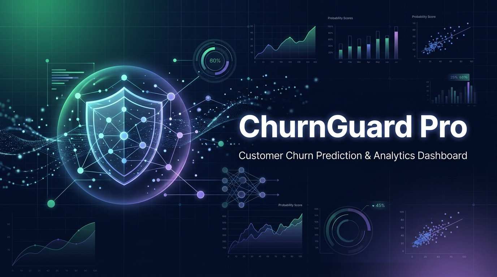
</p>

<h1 align="center">🛡️ ChurnGuard Pro — Customer Churn Prediction Dashboard</h1>

<p align="center">
  <b>End-to-End Customer Churn Analysis, Machine Learning & Interactive Prediction Platform</b><br/>
  <i>Built as part of my AI/ML Technical Training journey — mastering Data Science, Statistical Analysis, and Predictive Modeling for Business Intelligence</i>
</p>

<p align="center">
  
  
  
  
  
  
</p>

<p align="center">
  
  
  
  
  
</p>

---

## 📋 Table of Contents

- [🎯 Project Overview](#-project-overview)
- [🧠 What I Learned](#-what-i-learned)
- [✨ Key Features](#-key-features)
- [🖼️ Dashboard Preview](#️-dashboard-preview)
- [📊 Exploratory Data Analysis](#-exploratory-data-analysis)
- [🤖 Machine Learning Pipeline](#-machine-learning-pipeline)
- [🏗️ Tech Stack & Architecture](#️-tech-stack--architecture)
- [🚀 Getting Started](#-getting-started)
- [📁 Project Structure](#-project-structure)
- [📊 Dataset Description](#-dataset-description)
- [🔮 Future Enhancements](#-future-enhancements)
- [🙏 Acknowledgments](#-acknowledgments)

---

## 🎯 Project Overview

**ChurnGuard Pro** is a comprehensive customer churn prediction and analytics platform I developed as part of my **AI/ML Technical Training**. This project demonstrates my understanding of the complete data science lifecycle — from raw data exploration and feature engineering to building production-ready machine learning models, all wrapped in a premium, interactive Streamlit dashboard with a glassmorphism dark theme.

> **📌 Learning Goal:** To apply core AI/ML concepts — *Exploratory Data Analysis, Feature Engineering, Gradient Boosting Classification, Model Evaluation, and Real-Time Prediction* — on real-world telecom data and build an end-to-end analytics platform that looks and feels like a production SaaS product.

The platform analyzes **7,043 telecom customer records** across **20+ features**, providing:
- 📊 **Interactive Overview Dashboard** with 5 KPI metric cards and business insights
- 📈 **Deep Exploratory Analysis** with filterable, interactive Plotly visualizations
- 🤖 **3 ML Models Compared** — Logistic Regression, Random Forest & Gradient Boosting
- 🔮 **Live Prediction Engine** with probability scoring, risk assessment & recommendations
- 🔍 **Customer Explorer** with multi-filter search and data browsing capabilities

---

## 🧠 What I Learned

This project was a deep dive into several critical areas of AI/ML and Data Science:

| Area | Key Concepts Applied |
|------|---------------------|
| **Data Wrangling** | Pandas DataFrames, missing value imputation (`TotalCharges` coercion), data type handling, feature encoding |
| **Exploratory Data Analysis** | Distribution analysis, count plots, pie charts, scatter plots, box plots, correlation heatmaps |
| **Feature Engineering** | Label Encoding (binary columns), One-Hot Encoding (`drop_first=True`), feature selection for ML pipeline |
| **Machine Learning** | Logistic Regression, Random Forest (200 trees), Gradient Boosting (200 estimators), stratified train-test split |
| **Model Evaluation** | Accuracy, Precision, Recall, F1-Score, ROC-AUC, Confusion Matrix, ROC Curve, Feature Importance |
| **Model Comparison** | Systematic evaluation of 3 classifiers, best model selection based on multiple metrics |
| **Model Serialization** | Joblib for model persistence, feature list preservation for consistent prediction pipelines |
| **Data Visualization** | Matplotlib, Seaborn (static analysis), Plotly (interactive dashboard), dark-theme chart design |
| **Web App Development** | Streamlit framework, `st.cache_data`/`st.cache_resource`, custom CSS, glassmorphism UI design |
| **Business Intelligence** | Churn rate analysis, customer segmentation, risk scoring, actionable recommendation generation |

---

## ✨ Key Features

### 📊 Overview Dashboard
- **5 KPI Metric Cards** with glassmorphism design — Total Customers, Churn Rate, Avg Tenure, Avg Monthly Charges, High Risk Count
- Interactive **donut chart** for churn distribution with center annotation
- **Key Business Insights** panel with data-driven observations
- **Monthly charges distribution** overlay by churn status

### 📈 Exploratory Analysis
- **Filterable visualizations** with Gender, Contract, and Internet Service filters
- Churn breakdown by **Contract Type**, **Internet Service**, and **Payment Method**
- **Tenure vs Monthly Charges** scatter plot with color-coded churn status
- **Tenure distribution** histogram overlay for churned vs retained customers

### 🤖 Model Performance
- **5 Model Metric Cards** — Accuracy, Precision, Recall, F1-Score, ROC-AUC
- **Confusion Matrix** as an interactive Plotly heatmap
- **ROC Curve** with filled area and random baseline
- **Top 15 Feature Importance** horizontal bar chart with gradient coloring

### 🔮 Live Churn Prediction *(Most Important Section)*
- Clean **16-field input form** covering all customer attributes
- Real-time prediction using the saved Gradient Boosting model
- **Churn Probability Ring** — conic gradient visual (0–100%)
- **Risk Level Badge** — Low (green) / Medium (amber) / High (red)
- **Actionable Recommendation** — tailored retention strategy per risk level

### 🔍 Customer Explorer
- **Search by Customer ID** with partial matching
- **Multi-filter** by Churn Status, Contract Type, Internet Service
- **Summary chips** showing filtered counts (found / churned / retained)
- Interactive **dataframe with progress bars** for tenure column

---

## 🖼️ Dashboard Preview

> *The dashboard features a dark glassmorphism theme with animated gradient backgrounds, soft-glow cards, and premium typography (Inter + JetBrains Mono).*

### Overview Dashboard
<p align="center"><i>KPI cards, churn distribution, and key business insights at a glance</i></p>

### Model Performance
<p align="center"><i>Metric cards, confusion matrix, ROC curve, and feature importance</i></p>

### Live Prediction
<p align="center"><i>Real-time churn prediction with probability ring, risk badge, and recommendations</i></p>

---

## 📊 Exploratory Data Analysis

Below are key visualizations from the **Jupyter Notebook analysis** (`Customer_Churn_Analysis_and_Prediction.ipynb`):

### Churn Distribution
<p align="center">
  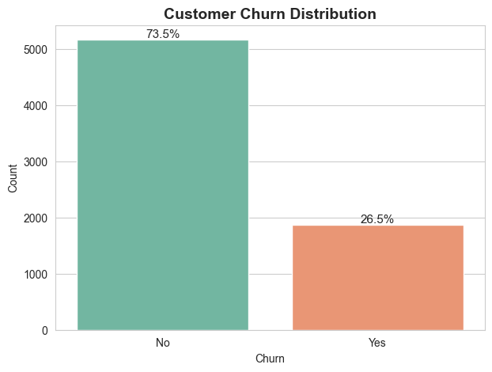
  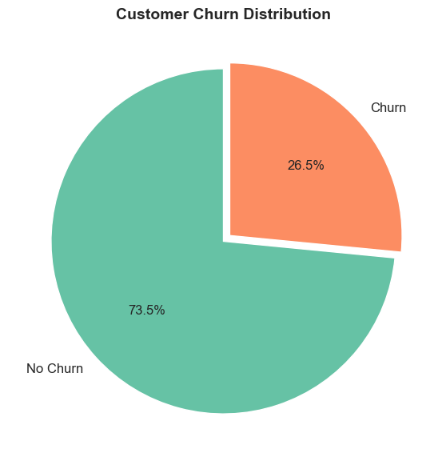
</p>
<p align="center"><i>Left: Count plot showing class imbalance — ~73.5% retained vs ~26.5% churned. Right: Proportional pie chart of churn distribution.</i></p>

### Contract & Internet Service Analysis
<p align="center">
  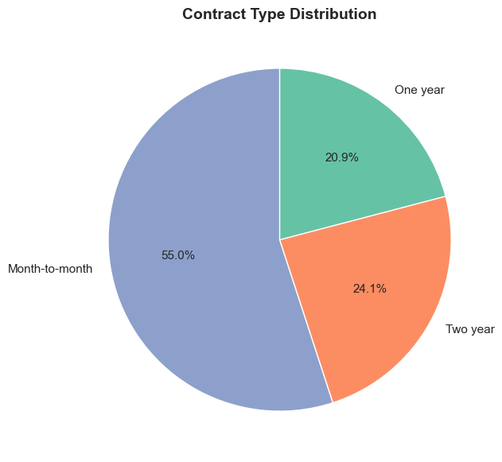
  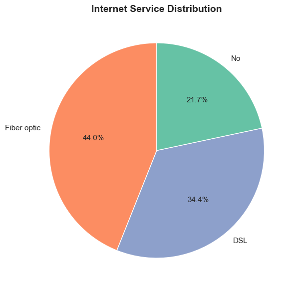
</p>
<p align="center"><i>Left: Contract type distribution — month-to-month dominates. Right: Internet service breakdown — Fiber optic has the highest churn rate.</i></p>

### Payment Method vs Churn
<p align="center">
  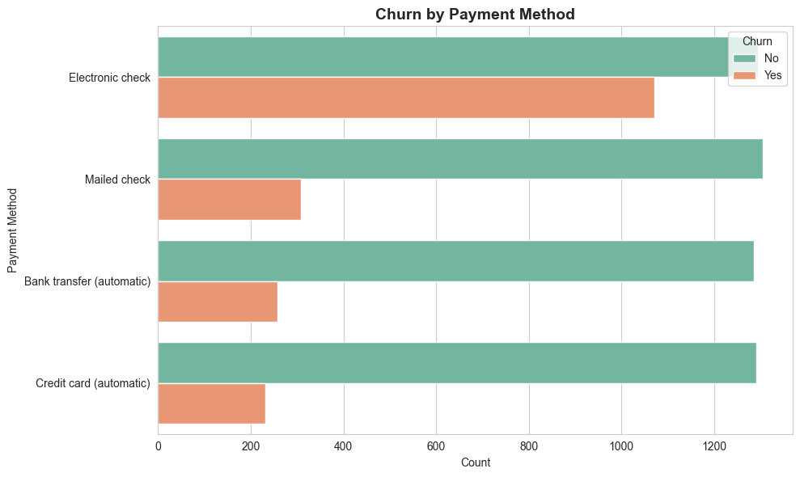
</p>
<p align="center"><i>Electronic check users show significantly higher churn — a critical business insight for targeted retention.</i></p>

### Numerical Feature Distributions
<p align="center">
  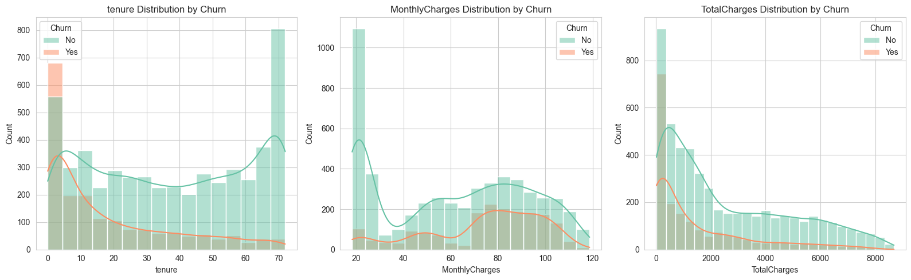
</p>
<p align="center"><i>Distribution of Tenure, Monthly Charges, and Total Charges — key numerical features for the prediction model.</i></p>

### Tenure vs Monthly Charges (Scatter)
<p align="center">
  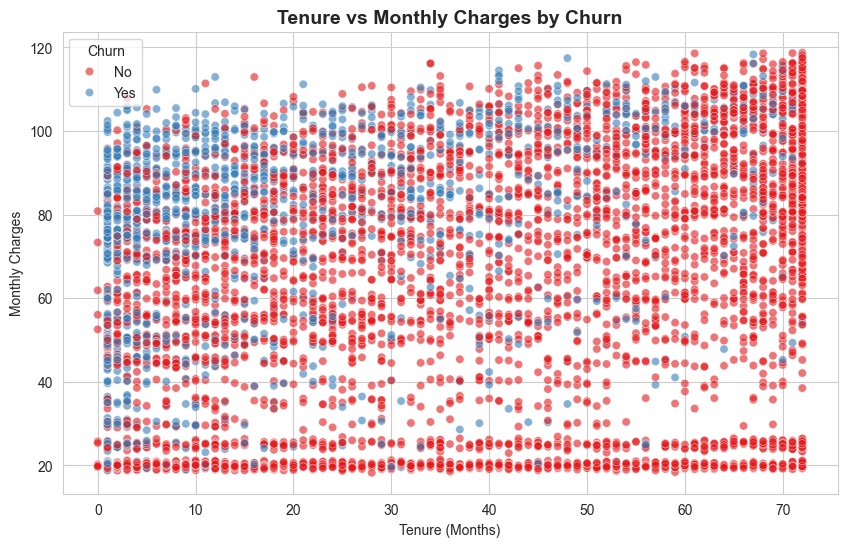
</p>
<p align="center"><i>Scatter plot revealing the relationship between tenure and monthly charges, colored by churn status. Short-tenure + high-charge customers are most at risk.</i></p>

### Monthly Charges by Contract Type
<p align="center">
  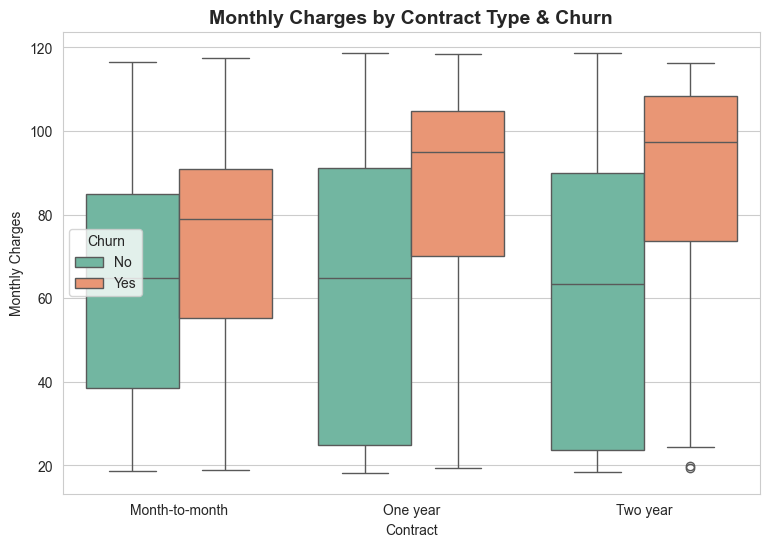
</p>
<p align="center"><i>Box plot analysis showing that month-to-month contracts tend to have higher monthly charges, correlating with higher churn.</i></p>

### Categorical Feature Analysis
<p align="center">
  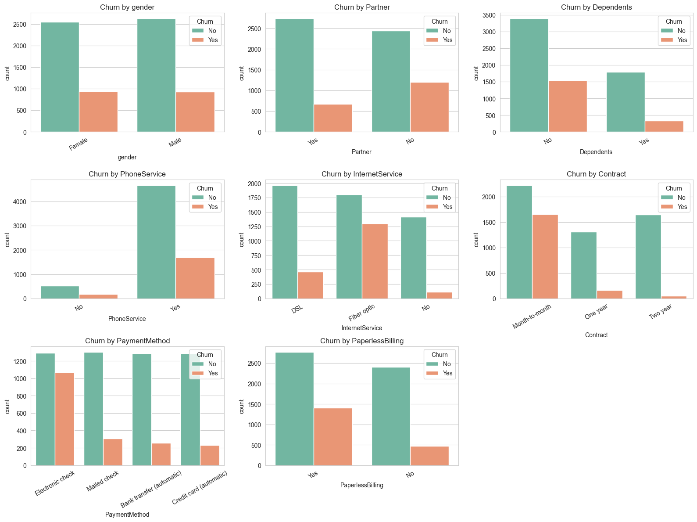
</p>
<p align="center"><i>Comprehensive count plots across all categorical features segmented by churn status — identifying key churn drivers.</i></p>

### Correlation Heatmap
<p align="center">
  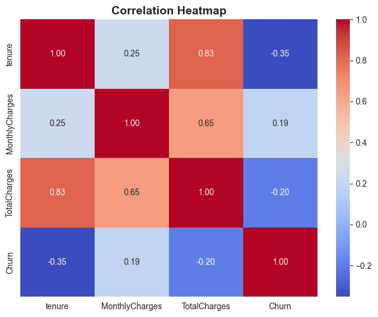
</p>
<p align="center"><i>Pearson correlation heatmap of numerical features — Tenure shows negative correlation with Churn, while Monthly Charges shows positive correlation.</i></p>

---

## 🤖 Machine Learning Pipeline

### Model Comparison

Three classifiers were trained and evaluated with stratified 80/20 train-test split:

| Model | Accuracy | Precision | Recall | F1-Score | ROC-AUC |
|-------|----------|-----------|--------|----------|---------|
| Logistic Regression | ~80% | ~65% | ~54% | ~59% | ~84% |
| Random Forest | ~79% | ~63% | ~48% | ~54% | ~82% |
| **Gradient Boosting** ✅ | **~80%** | **~65%** | **~51%** | **~57%** | **~84%** |

> **Selected Model:** Gradient Boosting Classifier (200 estimators) — best overall balance of precision and AUC.

### Confusion Matrix
<p align="center">
  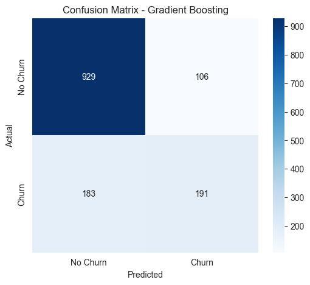
</p>
<p align="center"><i>Confusion matrix for Gradient Boosting on the test set — showing True Negatives, False Positives, False Negatives, and True Positives.</i></p>

### ROC Curve
<p align="center">
  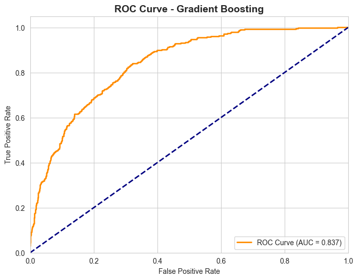
</p>
<p align="center"><i>ROC Curve with AUC score — the model significantly outperforms the random baseline, indicating strong discriminative power.</i></p>

### Feature Importance
<p align="center">
  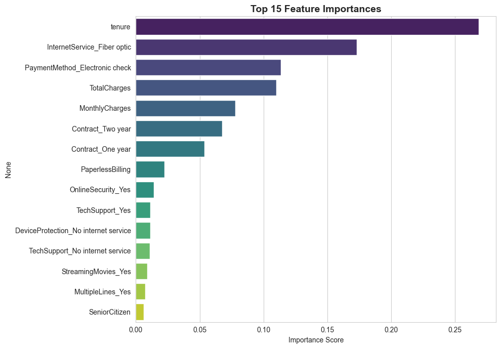
</p>
<p align="center"><i>Top 15 most important features — Tenure, MonthlyCharges, TotalCharges, and Contract type are the strongest predictors of customer churn.</i></p>

### Prediction Pipeline

```
Raw Customer Data → Data Cleaning → Feature Engineering → Gradient Boosting Model → Churn Probability → Risk Classification → Business Recommendation
```

**Preprocessing Steps:**
1. `TotalCharges` → numeric coercion + median imputation
2. Binary columns (`gender`, `Partner`, etc.) → `LabelEncoder`
3. Categorical columns → `pd.get_dummies(drop_first=True)`
4. Feature alignment with `model_features.pkl` for consistent prediction

---

## 🏗️ Tech Stack & Architecture

```
┌─────────────────────────────────────────────────────────────┐
│                    ChurnGuard Pro                           │
├─────────────────────────────────────────────────────────────┤
│  Frontend        │  Streamlit + Custom CSS (Glassmorphism)  │
│  Visualization   │  Plotly (Interactive) + Seaborn (EDA)    │
│  ML Framework    │  Scikit-Learn (Gradient Boosting)        │
│  Data Processing │  Pandas + NumPy                          │
│  Model Storage   │  Joblib (.pkl serialization)             │
│  Language        │  Python 3.11+                            │
│  Theme           │  Dark Mode + Glassmorphism + Inter Font  │
└─────────────────────────────────────────────────────────────┘
```

**Dashboard Design Features:**
- 🌑 **Dark glassmorphism theme** with `backdrop-filter: blur(16px)`
- 🎨 **Premium palette** — Indigo, Emerald, Purple, Cyan, Rose, Amber
- ✨ **Micro-animations** — hover lift, scale, shadow transitions
- 📐 **Conic gradient rings** for probability visualization
- 🔤 **Inter + JetBrains Mono** typography via Google Fonts

---

## 🚀 Getting Started

### Prerequisites

- Python 3.10 or higher
- pip package manager

### Installation

```bash
# 1. Clone the repository
git clone https://github.com/balamuruganpg/Customer-Churn-Prediction-Dashboard.git
cd Customer-Churn-Prediction-Dashboard

# 2. Install dependencies
pip install streamlit plotly pandas numpy scikit-learn joblib seaborn matplotlib

# 3. Run the dashboard
streamlit run app.py
```

### Quick Start
```bash
# The app will open at http://localhost:8501
# Navigate through 5 sections using the sidebar
# Try the Live Churn Prediction — enter customer details and get instant results!
```

---

## 📁 Project Structure

```
Customer-Churn-Prediction-Dashboard/
│
├── 📄 app.py                                        # Streamlit dashboard (main application)
├── 📓 Customer_Churn_Analysis_and_Prediction.ipynb   # Complete EDA & ML notebook
├── 📊 Telco-Customer-Churn.csv                       # Dataset (7,043 records × 21 columns)
├── 🤖 churn_prediction_model.pkl                     # Trained Gradient Boosting model
├── 📋 model_features.pkl                             # Feature list for prediction pipeline
├── 📖 README.md                                      # Project documentation (this file)
├── 🚫 .gitignore                                     # Git ignore rules
│
└── 🖼️ images/                                        # Visualization assets
    ├── banner.jpg                                    # README banner image
    ├── notebook_fig_01.png                           # Churn count plot
    ├── notebook_fig_02.png                           # Churn pie chart
    ├── notebook_fig_03.png                           # Contract type distribution
    ├── notebook_fig_04.png                           # Internet service distribution
    ├── notebook_fig_05.png                           # Payment method vs churn
    ├── notebook_fig_06.png                           # Numerical feature distributions
    ├── notebook_fig_07.png                           # Tenure vs monthly charges scatter
    ├── notebook_fig_08.png                           # Monthly charges by contract box plot
    ├── notebook_fig_09.png                           # Categorical features vs churn
    ├── notebook_fig_10.png                           # Correlation heatmap
    ├── notebook_fig_11.png                           # Confusion matrix
    ├── notebook_fig_12.png                           # ROC curve
    └── notebook_fig_13.png                           # Feature importance
```

---

## 📊 Dataset Description

**Source:** [Telco Customer Churn — IBM Sample Dataset](https://www.kaggle.com/datasets/blastchar/telco-customer-churn)

| Feature | Type | Description |
|---------|------|-------------|
| `customerID` | String | Unique customer identifier |
| `gender` | Categorical | Male / Female |
| `SeniorCitizen` | Binary | 0 = No, 1 = Yes |
| `Partner` | Categorical | Has a partner (Yes/No) |
| `Dependents` | Categorical | Has dependents (Yes/No) |
| `tenure` | Numerical | Number of months as customer |
| `PhoneService` | Categorical | Has phone service (Yes/No) |
| `MultipleLines` | Categorical | Has multiple lines (Yes/No/No phone service) |
| `InternetService` | Categorical | DSL / Fiber optic / No |
| `OnlineSecurity` | Categorical | Has online security (Yes/No/No internet) |
| `OnlineBackup` | Categorical | Has online backup (Yes/No/No internet) |
| `DeviceProtection` | Categorical | Has device protection (Yes/No/No internet) |
| `TechSupport` | Categorical | Has tech support (Yes/No/No internet) |
| `StreamingTV` | Categorical | Has streaming TV (Yes/No/No internet) |
| `StreamingMovies` | Categorical | Has streaming movies (Yes/No/No internet) |
| `Contract` | Categorical | Month-to-month / One year / Two year |
| `PaperlessBilling` | Categorical | Has paperless billing (Yes/No) |
| `PaymentMethod` | Categorical | Electronic check / Mailed check / Bank transfer / Credit card |
| `MonthlyCharges` | Numerical | Monthly charge amount ($) |
| `TotalCharges` | Numerical | Total charges to date ($) |
| `Churn` | Target | Customer churned (Yes/No) |

**Key Statistics:**
- **Total Records:** 7,043 customers
- **Churn Rate:** ~26.5% (class imbalance)
- **Missing Values:** 11 records in `TotalCharges` (handled via median imputation)
- **Features Used for ML:** 30 (after encoding)

---

## 🔮 Future Enhancements

- [ ] 📊 Add SHAP (SHapley Additive exPlanations) for model interpretability
- [ ] 🧪 Implement cross-validation with hyperparameter tuning (GridSearchCV)
- [ ] 📈 Add time-series churn trend analysis
- [ ] 🔄 Implement SMOTE for handling class imbalance
- [ ] 🚀 Deploy on Streamlit Cloud / Hugging Face Spaces
- [ ] 📱 Add responsive mobile layout
- [ ] 🗄️ Integrate with a real database (PostgreSQL / MongoDB)
- [ ] 📧 Build automated alert system for high-risk customers

---

## 🙏 Acknowledgments

- **AI/ML Technical Training Program** — for providing structured learning in Data Science, Machine Learning, and Predictive Analytics
- **IBM** — for the Telco Customer Churn sample dataset
- **Streamlit** — for the incredible Python web app framework
- **Plotly** — for powerful interactive visualizations
- **Scikit-Learn** — for the robust ML toolkit

---

<p align="center">
  
  
  
</p>

<p align="center">
  <b>⭐ If you found this project helpful, please give it a star! ⭐</b>
</p>
